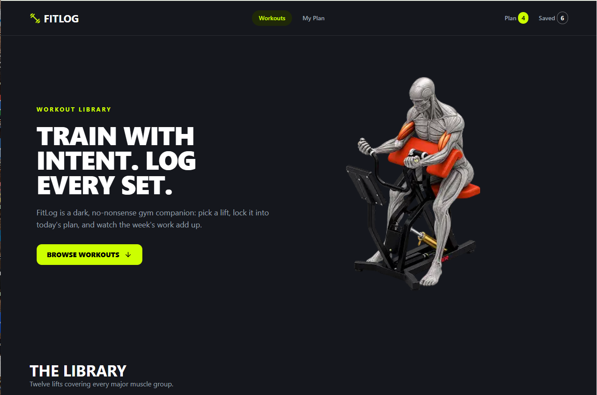

# 🏋️ FitLog – Fitness Tracking Application

FitLog is a fitness tracking web application built with Next.js, React, and TypeScript. It helps users explore fitness plans, view workout information, mark workouts as completed, and track their progress.

<p align="center">
  <a href="https://fit-log-beige-ten.vercel.app/">
    
  </a>
  <a href="https://github.com/biddut-webdev/fit-log">
    
  </a>
</p>

---

## 📸 Project Screenshot

<p align="center">
  
</p>

---

## ✨ Features

- 🏋️ Explore available fitness plans and workout information.
- 📋 View workout details.
- ✅ Mark workouts as completed.
- 📊 Track workout completion progress.
- 💾 Save completed workout status using browser localStorage.
- 🎯 Manage workout activities through a user-friendly interface.
- 📱 Responsive design for different screen sizes.
- 🔔 Display notifications using toast messages.

---

## 🛠️ Technologies Used

| Technology | Purpose |
|---|---|
| Next.js 16.3.6 | React framework |
| React 19.2.8 | UI development |
| TypeScript | Type safety |
| Tailwind CSS 4.3.3 | Styling |
| daisyUI 5.7.44 | UI components |
| Lucide React | Icons |
| React Hot Toast | Notifications |
| REST API | Fitness data |

---

## 📦 Dependencies

### Production Dependencies

| Package | Version |
|---|---|
| `next` | `16.3.6` |
| `react` | `19.2.8` |
| `react-dom` | `19.2.8` |
| `lucide-react` | `^1.48.0` |
| `react-hot-toast` | `^2.6.1` |

### Development Dependencies

| Package | Version |
|---|---|
| `@tailwindcss/postcss` | `^4.3.3` |
| `@types/node` | `^20` |
| `@types/react` | `^19` |
| `@types/react-dom` | `^19` |
| `daisyui` | `^5.7.44` |
| `eslint` | `^9` |
| `eslint-config-next` | `16.3.6` |
| `tailwindcss` | `^4.3.3` |
| `typescript` | `^5` |

---

## 🚀 Getting Started

Follow these steps to run the project locally.

### Prerequisites

- Node.js
- npm
- Git

### 1. Clone the Repository

```bash
git clone https://github.com/biddut-webdev/fit-log.git
```

### 2. Navigate to the Project Folder

```bash
cd fit-log
```

### 3. Install Dependencies

```bash
npm install
```

### 4. Run the Development Server

```bash
npm run dev
```

### 5. Open in Browser

Visit:

```text
http://localhost:3000
```

---

## 📜 Available Scripts

| Command | Description |
|---|---|
| `npm run dev` | Start development server |
| `npm run build` | Build the application |
| `npm run start` | Start production server |
| `npm run lint` | Run ESLint |

---

## 🌐 Live Demo

**[Visit FitLog](https://fit-log-beige-ten.vercel.app/)**

## 👨‍💻 Author

**Biddut Hossen**

- GitHub: [biddut-webdev](https://github.com/biddut-webdev)
- Email: biddutem60@gmail.com

---

<p align="center">
  ⭐ If you like this project, consider giving it a star!
</p>
